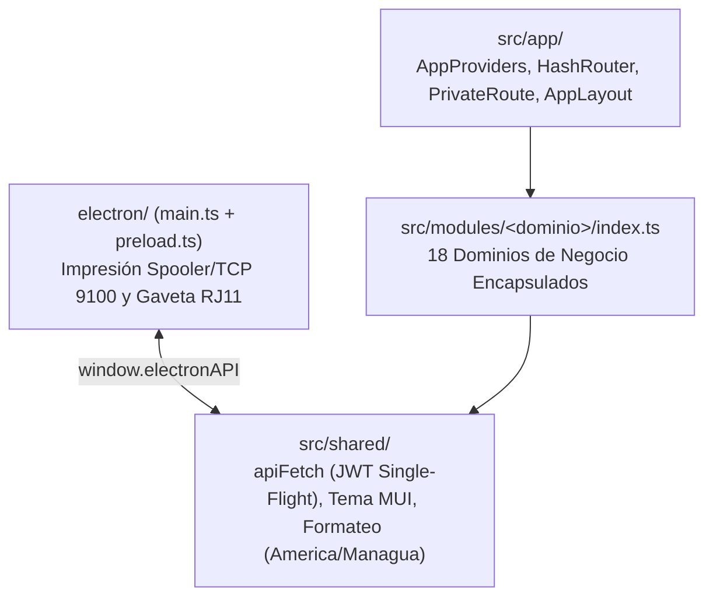
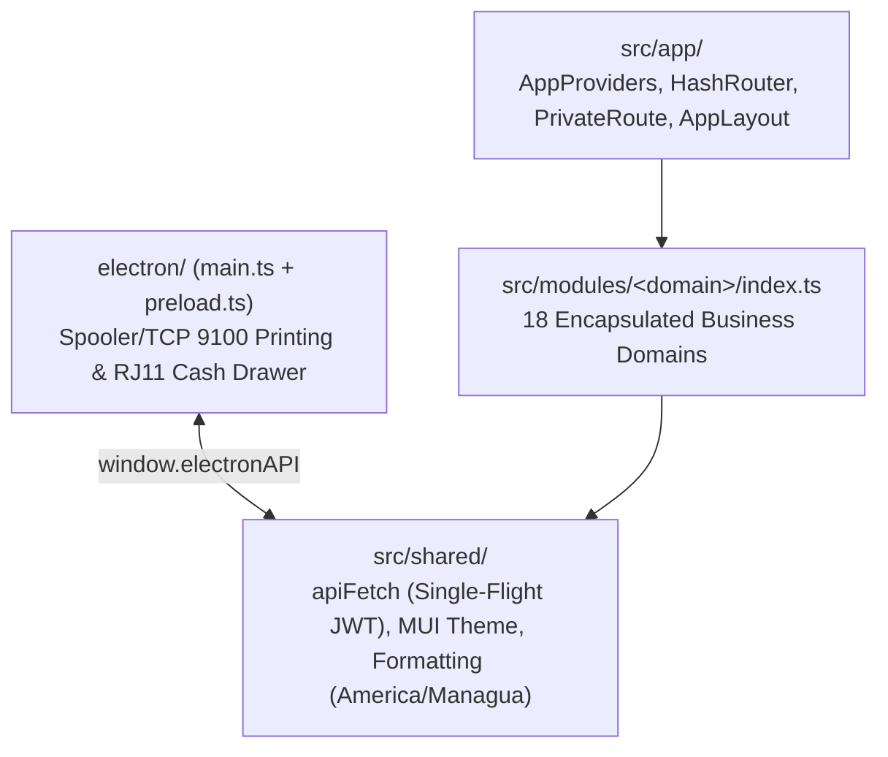

<div align="center">

# 🍕 Pizza To Go POS — App-Factura (Frontend & Electron)

**Cliente de Escritorio y Web para Punto de Venta (POS), Facturación, Cocina (KDS), Despacho y Administración**  
*Desktop & Web Client for Point of Sale (POS), Invoicing, Kitchen Display (KDS), Delivery Dispatch & Administration*

[](https://react.dev/)
[](https://www.typescriptlang.org/)
[](https://vite.dev/)
[](https://mui.com/)
[](https://www.electronjs.org/)
[](./Dockerfile)

### 🌐 Idioma / Language: [🇪🇸 Español](#-español) | [🇺🇸 English](#-english)

</div>

---

<a id="-español"></a>

# 🇪🇸 Español

## 📋 Tabla de Contenidos

1. [Arquitectura Domain-Driven Modular (DDM)](#-arquitectura-domain-driven-modular-ddm)
2. [Mapa de Módulos de Negocio](#-mapa-de-módulos-de-negocio)
3. [Características Operativas Clave](#-características-operativas-clave)
4. [Requisitos e Instalación Local](#-requisitos-e-instalación-local)
5. [Ejecución con Docker](#-ejecución-con-docker)
6. [Scripts Disponibles](#-scripts-disponibles)

---

## 🏛️ Arquitectura Domain-Driven Modular (DDM)

El proyecto organiza el código del renderer bajo una jerarquía unidireccional estricta (`app -> modules -> shared`), aislada del proceso principal de escritorio (`electron/`):



- **Regla de Encapsulamiento**: Cada módulo en `src/modules/<dominio>/` expone su contrato público exclusivamente a través de su archivo `index.ts`. Ningún módulo externo puede importar archivos internos de otro módulo (verificado automáticamente por `npm test`).
- **Sistema de Diseño**: Construido íntegramente con **Material UI (`@mui/material`, `@mui/x-data-grid`)** y tokens centralizados en `src/shared/theme/`.

---

## 🧩 Mapa de Módulos de Negocio

| Módulo (`src/modules/`) | Responsabilidad Principal |
| :--- | :--- |
| `auth` | Inicio de sesión (credenciales/PIN), sesión activa, permisos (`hasPermission`) y bloqueo por inactividad. |
| `accounts` | Administración de usuarios, roles personalizados (`AccessRole`), matriz de permisos y horarios de personal. |
| `orders` | Ciclo de vida de pedidos, comandos `CQS`, sincronización `Socket.IO` y reconciliación por `updatedAt`. |
| `checkout` | Diálogo de cobro, pagos mixtos/multidivisa (`NIO`/`USD`), división de cuentas (`splitCheckout`) y certificados. |
| `tables` | Mapa interactivo de salón por plantas, estados de mesa (`disponible`, `ocupado`, `reservado`) y asignación de zonas. |
| `catalog` | Gestión de categorías, productos, tamaños, extras e ítems de combos. |
| `kitchens` | Pantalla de cocina (`KDS`), ruteo de tickets por estación de cocina y alertas sonoras en tiempo real. |
| `delivery` | Panel de despacho y vista dedicada para motorizados (`DriverDeliveriesPage`). |
| `cash-register` | Apertura de turno, gastos operativos de caja (`CashExpense`), previsualización y arqueo de cierre. |
| `invoices` | Historial de facturas emitidas, reimpresión controlada y anulación con motivo/merma. |
| `promotions` | Configuración de Happy Hour (`2x1`, porcentaje, monto fijo), descuentos, cupones y certificados de regalo. |
| `customers` | Directorio de clientes, direcciones de entrega y búsqueda rápida en facturación. |
| `reports` | Reportes analíticos de ventas, métodos de pago, desempeño y exportación de datos. |
| `devices` | Configuración de impresoras térmicas (USB/Spooler y Red TCP 9100), failover y prueba de gaveta RJ11. |
| `backups` | Generación, descarga, carga y restauración de respaldos de base de datos. |
| `audit` | Visor de bitácora del sistema (`SystemLog`) con filtros por módulo, severidad y usuario. |
| `settings` | Datos fiscales del negocio, resoluciones de correlativos (`Correlativo`) y preferencias de interfaz. |
| `health` | Guardia de disponibilidad del backend (`BackendHealthGuard`) antes de habilitar la operación. |

---

## ✨ Características Operativas Clave

- **Sincronización en Tiempo Real sin Regresiones**:
  - Los comandos de mutación (`useOrderContentCommands`, `useOrderStatusCommands`, `useOrderFinalizationCommand`) reconcilian respuestas HTTP contra eventos `Socket.IO` usando `updatedAt` para que una respuesta lenta nunca pise un estado más reciente.
- **Concurrencia Optimista Selectiva (`expectedUpdatedAt`)**:
  - Protege mutaciones comerciales (`updateItems`, `finalize`, `splitCheckout`, `cancelled`) contra ediciones simultáneas (`409 Conflict`), manteniendo libres de fricción las acciones operativas de cocina (`KDS`).
- **Impresión Térmica Resiliente (`Electron`)**:
  - Si una impresora principal falla, `printerDispatcherService` intenta la impresora de respaldo configurada y conserva los trabajos pendientes (`pendingJobs` / `printedJobIds`) para reintentar sin duplicar tickets ya impresos.

---

## 🚀 Requisitos e Instalación Local

### 1. Requisitos previos
- **Node.js** `20.x` o superior.
- **Backend (`pizza-app-backend-nest`)** activo y accesible en la URL configurada en `VITE_API_BASE_URL`.

### 2. Configurar variables de entorno

```bash
cp .env.example .env
```

Contenido de `.env`:

```env
VITE_API_BASE_URL=http://localhost:3000
```

### 3. Instalar dependencias y ejecutar

```bash
npm install
npm run dev
```

---

## 🐳 Ejecución con Docker

```bash
# Construir la imagen Web del Frontend
docker build --build-arg VITE_API_BASE_URL=http://localhost:3000 -t pizza-frontend .

# Ejecutar el contenedor en el puerto 5173
docker run -p 5173:5173 pizza-frontend
```

*(Si utilizas el archivo `docker-compose.yml` del entorno completo, basta con ejecutar `docker compose up --build`).*

---

## 📜 Scripts Disponibles

| Comando | Descripción |
| :--- | :--- |
| `npm run dev` | Inicia Vite + Electron en modo desarrollo con recarga en caliente (`HMR`). |
| `npm run build:web` | Compila la versión Web de producción en la carpeta `dist/`. |
| `npm run build` | Verifica tipos (`tsc`), compila el proyecto y empaqueta el instalador de Windows (`electron-builder`). |
| `npm test` | Ejecuta las pruebas automáticas de fronteras de arquitectura y contratos (`tests/architecture-and-contracts.test.mjs`). |
| `npm run lint` | Ejecuta ESLint sin permitir advertencias (`--max-warnings 0`). |
| `npm run preview` | Sirve localmente la compilación generada en `dist/`. |

---
---

<a id="-english"></a>

# 🇺🇸 English

## 📋 Table of Contents

1. [Domain-Driven Modular (DDM) Architecture](#-domain-driven-modular-ddm-architecture)
2. [Business Domain Modules](#-business-domain-modules)
3. [Key Operational Capabilities](#-key-operational-capabilities)
4. [Prerequisites & Local Installation](#-prerequisites--local-installation)
5. [Running with Docker](#-running-with-docker)
6. [Available Scripts](#-available-scripts)

---

## 🏛️ Domain-Driven Modular (DDM) Architecture

The renderer codebase follows a strict unidirectional dependency hierarchy (`app -> modules -> shared`), isolated from the Electron main process (`electron/`):



- **Strict Encapsulation**: Every domain module under `src/modules/<domain>/` exposes its public contract exclusively via `index.ts`. Cross-module deep imports are forbidden and automatically verified by `npm test`.
- **Design System**: Built exclusively with **Material UI (`@mui/material`, `@mui/x-data-grid`)** using centralized theme tokens in `src/shared/theme/`.

---

## 🧩 Business Domain Modules

| Module (`src/modules/`) | Core Responsibility |
| :--- | :--- |
| `auth` | Authentication (credentials/PIN), active session state, permission checks (`hasPermission`), and inactivity lock. |
| `accounts` | User management, custom roles (`AccessRole`), permission matrix, and staff schedules. |
| `orders` | Order lifecycle, `CQS` mutation commands, `Socket.IO` synchronization, and `updatedAt` reconciliation. |
| `checkout` | Checkout dialog, split/multi-currency payments (`NIO`/`USD`), bill splitting (`splitCheckout`), and gift certificates. |
| `tables` | Interactive multi-floor dining room map, table status (`disponible`, `ocupado`, `reservado`), and waiter zones. |
| `catalog` | Categories, products, sizes, category extras, and combo groups/options. |
| `kitchens` | Kitchen Display System (`KDS`), per-station ticket routing, and real-time audio alerts. |
| `delivery` | Delivery dispatch board and dedicated driver view (`DriverDeliveriesPage`). |
| `cash-register` | Shift opening, operational cash expenses (`CashExpense`), close preview, and shift reconciliation. |
| `invoices` | Issued invoices history, controlled ticket reprinting, and void/waste cancellation workflows. |
| `promotions` | Happy Hour (`2x1`, percentage, fixed amount), discounts, coupons, and gift certificates. |
| `customers` | Customer directory, delivery addresses, and fast checkout lookup. |
| `reports` | Sales analytics, payment method breakdowns, staff performance, and report exports. |
| `devices` | Thermal printer configuration (Windows Spooler & TCP 9100), backup printer failover, and RJ11 drawer testing. |
| `backups` | Database backup generation, download, upload, and transactional restore. |
| `audit` | System audit log viewer (`SystemLog`) with module, severity, and user filters. |
| `settings` | Business tax profile, invoice numbering resolutions (`Correlativo`), and UI preferences. |
| `health` | Backend availability guard (`BackendHealthGuard`) prior to enabling POS operations. |

---

## ✨ Key Operational Capabilities

- **Regression-Free Real-Time Synchronization**:
  - Order mutation commands (`useOrderContentCommands`, `useOrderStatusCommands`, `useOrderFinalizationCommand`) reconcile HTTP responses against `Socket.IO` events via `updatedAt` so delayed HTTP responses never overwrite newer state.
- **Selective Optimistic Concurrency (`expectedUpdatedAt`)**:
  - Protects commercial mutations (`updateItems`, `finalize`, `splitCheckout`, `cancelled`) against concurrent edits (`409 Conflict`) while keeping kitchen operational updates (`KDS`) friction-free.
- **Resilient Thermal Printing (`Electron`)**:
  - When a primary printer fails, `printerDispatcherService` automatically falls back to the configured backup printer and tracks `pendingJobs` / `printedJobIds` to retry failed tickets without duplicating already-printed receipts.

---

## 🚀 Prerequisites & Local Installation

### 1. Prerequisites
- **Node.js** `20.x` or higher.
- **Backend (`pizza-app-backend-nest`)** running and reachable at `VITE_API_BASE_URL`.

### 2. Configure environment variables

```bash
cp .env.example .env
```

Default `.env` content:

```env
VITE_API_BASE_URL=http://localhost:3000
```

### 3. Install dependencies and run

```bash
npm install
npm run dev
```

---

## 🐳 Running with Docker

```bash
# Build the Frontend Web image
docker build --build-arg VITE_API_BASE_URL=http://localhost:3000 -t pizza-frontend .

# Run the container on port 5173
docker run -p 5173:5173 pizza-frontend
```

*(If using the full-stack `docker-compose.yml` setup, simply run `docker compose up --build`).*

---

## 📜 Available Scripts

| Command | Description |
| :--- | :--- |
| `npm run dev` | Starts Vite + Electron in development mode with Hot Module Replacement (`HMR`). |
| `npm run build:web` | Builds the production Web bundle into `dist/`. |
| `npm run build` | Type-checks (`tsc`), builds the app, and packages the Windows installer (`electron-builder`). |
| `npm test` | Runs the automated architecture and contract test suite (`tests/architecture-and-contracts.test.mjs`). |
| `npm run lint` | Runs ESLint with zero-warning tolerance (`--max-warnings 0`). |
| `npm run preview` | Locally serves the production build in `dist/`. |
